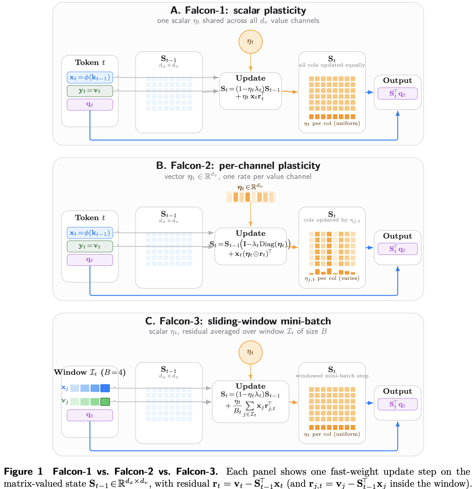

# Fast Weight Attention

[](https://arxiv.org/abs/2608.27763) 
[](https://yifanzhang-pro.github.io/fast-weight-attention/fast-weight-attention.pdf) 
[](https://yifanzhang-pro.github.io/fast-weight-attention) 
[](https://opensource.org/licenses/Apache-2.0) 
[](https://www.python.org/downloads/) 

### Falcon: Fast Weight Attention for Continual Learning

Recurrent fast-weight memories and selective state-space models compress a growing context into a bounded state, their writes can therefore be viewed as online continual-learning rules.

**Authors:** Yifan Zhang, Steve Ta, Jasper Zhang, Jichen Feng, Shuzhen Li, Yongxin Zhang, Yifeng Liu, Huizhuo Yuan, Mengdi Wang&dagger;, Quanquan Gu&dagger;, Andrew Chi-Chih Yao&dagger;

**Date:** March 9, 2026

[[arXiv](https://arxiv.org/abs/2608.27763)] [[Project Page](https://github.com/yifanzhang-pro/fast-weight-attention)] [[Webpage](https://yifanzhang-pro.github.io/fast-weight-attention)] [[Paper](https://yifanzhang-pro.github.io/fast-weight-attention/fast-weight-attention.pdf)] 




## Citation

```bibtex
@article{zhang2026fast,
  title = {Fast Weight Attention for Continual Learning},
  author = {Zhang, Yifan and Ta, Steve and Zhang, Jasper and Feng, Jichen and Li, Shuzhen and Zhang, Yongxin and Liu, Yifeng and Yuan, Huizhuo and Wang, Mengdi and Gu, Quanquan and Yao, Andrew Chi-Chih},
  journal = {arXiv preprint arXiv:2608.27763},
  year = {2026},
  month = {March},
  url = "https://arxiv.org/abs/2608.27763"
}
```
